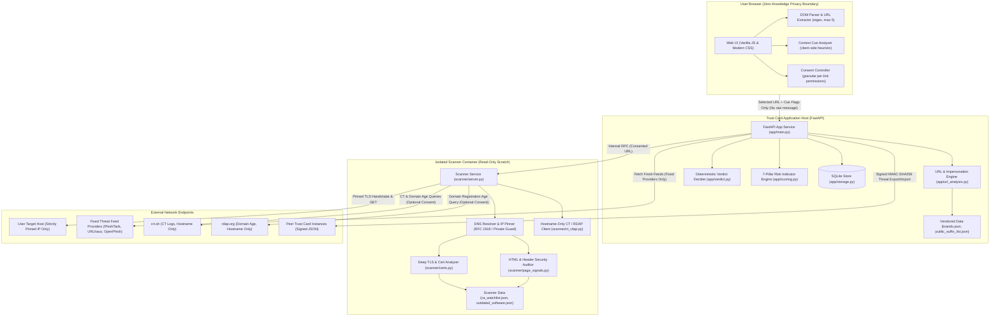

# Trust Card Architecture & Technical Specification

Trust Card is an intelligent, multi-layered security platform that detects phishing, malicious infrastructure, fraudulent payment links, impersonation, and certificate trust breakdowns while enforcing strict browser-side privacy boundaries.

---

## 1. System Architecture & Trust Boundaries

Trust Card employs strict architectural isolation between the user's browser, the local analysis application, and the network scanning sandbox.

---

## 2. Execution Traces

### Trace 1: From Message Paste to Trust Card Rendering
1. **Pasting & Extraction (Browser)**:
   - User pastes a message (e.g., an SMS claiming an urgent refund or UPI request).
   - `context.mjs` extracts up to 5 unique HTTP/HTTPS links and detects cue categories (`urgency`, `credential_request`, `payment_request`, `personal_data_request`).
   - The user selects the link to check.
   - **Privacy Invariant**: The browser transmits *only* `{"url": selectedUrl, "mode": "local", "context_flags": [...]}`. The raw message is discarded and never leaves browser memory.
2. **Local Evaluation (FastAPI App)**:
   - `canonicalize_url()` standardizes the URL and strips fragments and credentials.
   - `url_hash()` and `indicator_fingerprint()` are computed.
   - `analyze_url()` inspects IDN/Punycode homoglyphs, brand lookalikes (edit distance, swaps like `rn` $\to$ `m`, `0` $\to$ `o`), URL structure, and fraud keywords.
   - Feeds and community reports are queried in SQLite.
   - If `mode == "local"`, verdicts and the 7-pillar indicator score are returned immediately.
3. **Live Scan with Granular Consent**:
   - If the user requests a live scan, the modal displays every outbound request type (target IP, and optionally crt.sh and rdap.org).
   - Scanner resolves DNS once, validates against RFC 1918 / loopback / link-local addresses, and pins the IP.
   - Full TLS handshake verifies the leaf certificate, SAN matches, cryptographic key strength, and tests for weak RSA key generation (trial division by primes $< 10{,}000$).
   - A non-verifying fallback handshake captures raw DER bytes if the certificate fails validation.
   - Pinned HTTP request fetches page headers and up to 256 KiB of HTML to audit security headers, form action targets, hidden iframes, and script obfuscation.
   - Results are synthesized into the final verdict, certificate details block, and 7-pillar breakdown.

### Trace 2: Threat Feed Refresh Flow
1. User confirms feed update in UI (`/api/v1/intel/refresh`).
2. App sends requests *only* to fixed named provider hosts:
   - `PhishTank`: `data.phishtank.com/data/online-valid.csv`
   - `URLhaus`: `urlhaus.abuse.ch/downloads/csv_recent/`
   - `OpenPhish`: `openphish.com/feed.txt`
3. Each provider request enforces `_StrictSameHostRedirect` (never redirects to arbitrary hosts) and strict timeout/size limits.
4. Entries are parsed, canonicalized, hashed with SHA-256, and atomically updated in SQLite.

### Trace 3: Collaborative Threat Sharing (Cross-Instance Signed Sync)
1. **Export** (`GET /api/v1/admin/export`):
   - Authenticated administrator requests approved threat reports.
   - Only query-free indicator fingerprints, hosts, categories, report counts, and creation timestamps are exported.
   - App computes HMAC-SHA256 signature using `SHARING_KEY` and sets `X-Signature`.
2. **Import** (`POST /api/v1/admin/import`):
   - Receiving instance validates HMAC-SHA256 against configured key.
   - Rejects payloads $> 1$ MiB.
   - Inserts reports into local SQLite with `state = 'unverified'` and `source = 'Peer: <peer-name>'`.
   - Imported indicators *never* auto-approve; they require local admin review.

---

## 3. Hackathon Problem Statement Coverage Matrix

| Hackathon Requirement | Implementation File(s) | Key Feature / Logic | Unit Test Coverage |
| :--- | :--- | :--- | :--- |
| **Phishing & Credential Harvesting** | `scanner/page_signals.py`, `app/verdict.py` | Detects cross-site password forms, plain HTTP password forms, form actions to raw IPs or form builders, hidden login iframes. | `tests/test_page_signals.py::test_cross_site_password_form` |
| **Fraudulent Payment Links & UPI Scams** | `app/url_analysis.py`, `app/data/brands.json` | Indian payment targets (SBI, HDFC, ICICI, Paytm, PhonePe, BharatPe, BHIM, IRCTC) with swap and lookalike detection. | `tests/test_url_analysis.py::test_indian_targets_detected` |
| **Fake Recruitment Portals** | `app/url_analysis.py`, `app/data/brands.json` | Job portal targets (Naukri, Indeed, LinkedIn, Internshala) and fraud keyword recognition (`interview`, `offer letter`, `registration fee`). | `tests/test_url_analysis.py::test_fraud_keywords` |
| **Impersonation & Lookalike Domains** | `app/url_analysis.py` | Punycode / IDN homoglyphs, Levenshtein edit distance $\le 2$, digit/letter substitutions (`rn` $\leftrightarrow$ `m`, `0` $\leftrightarrow$ `o`, `1` $\leftrightarrow$ `l`), brand-in-subdomain on unrelated registrable domain. | `tests/test_url_analysis.py::test_punycode_and_idn_homoglyph_detection`, `test_brand_lookalike_rn_substitution` |
| **Malicious Redirects** | `scanner/engine.py`, `scanner/page_signals.py` | Follows up to 5 redirects with loop detection, records intermediate hosts, flags `<meta http-equiv="refresh">` pointing off-site. | `tests/test_page_signals.py::test_meta_refresh_redirect_to_third_party`, `tests/test_scanner.py::test_redirect_loop_detected` |
| **Certificate Validation & Expiration** | `scanner/certs.py` | Expired certs, not-yet-valid certs, validity $> 398$ days, hostname mismatch against SANs with RFC 6125 wildcard handling, self-signed detection. | `tests/test_certs.py::test_expired_certificate_flagged_medium`, `test_hostname_mismatch_flagged_medium` |
| **Weak Cryptography & Bad CA Key Gen (eMudhra Theme)** | `scanner/certs.py`, `scanner/data/weak_key_fingerprints.json` | Flags RSA $< 2048$ bits, MD5/SHA-1 signatures, non-standard curves. Performs small-prime trial division ($p < 10{,}000$) on RSA modulus to catch shared factors; compares SPKI against weak key fingerprints. | `tests/test_certs.py::test_weak_key_generation_small_prime_factor`, `test_weak_rsa_key_below_2048_flagged_medium` |
| **CA Watchlist & Trust Infrastructure** | `scanner/certs.py`, `scanner/data/ca_watchlist.json` | Watchlist of certificate authorities under review or distrusted with conservative, non-defamatory findings. | `tests/test_certs.py::test_ca_watchlist_match_flagged_conservative_medium` |
| **Certificate Transparency & Continuous Monitoring** | `scanner/ct_rdap.py`, `scanner/certs.py` | Flags leaves without embedded SCTs. With explicit consent, queries `crt.sh` for certificates issued in last 7 days without prior history or $\ge 3$ distinct CAs in 30 days. | `tests/test_certs.py::test_ct_rdap_mock_lookups` |
| **Domain Registration Age** | `scanner/ct_rdap.py` | With consent, queries RDAP for creation date; flags domains $< 30$ days old as medium risk. | `tests/test_certs.py::test_domain_age_medium_contributes_to_suspicious` |
| **Application Weaknesses & Outdated Software** | `scanner/page_signals.py`, `scanner/data/outdated_software.json` | Audits HSTS (checks $\ge 15{,}552{,}000$s), CSP `unsafe-inline`, `X-Frame-Options`, `X-Content-Type-Options`, `Referrer-Policy`, `Permissions-Policy`, insecure cookies, and matches `Server`/`X-Powered-By` banners against known outdated versions. | `tests/test_page_signals.py::test_hsts_short_max_age`, `test_information_disclosure_and_outdated_software` |
| **7-Pillar Risk Synthesis & Explainability** | `app/scoring.py`, `docs/SCORING.md` | Computes weighted score across 7 pillars: Threat Intel (35%), URL/Brand (20%), Page Content (25%), Certificate (15%), Community (25% if present), Context (15%), Web Security (5%). Explicitly displays checked vs unchecked checks. | `tests/test_scoring.py::test_local_only_marks_live_pillars_unchecked`, `test_invariant_technical_findings_never_yield_known_threat` |
| **Collaborative Threat Intelligence & Sharing** | `app/storage.py`, `app/main.py`, `docs/API.md` | Report count deduplication, host-level reputation ($\ge 2$ approved reports flag other host paths), optional auto-approval threshold, HMAC-SHA256 signed import/export. | `tests/test_sharing.py::test_repeat_reports_increment_count`, `test_export_and_import_with_signature` |

---

## 4. Threat Model & Security Invariants

### Defended Scenarios
1. **Credential harvesting over HTTP or cross-domain**: Detected via form action analysis and RFC 6125 eTLD+1 public suffix parsing.
2. **Deceptive and homoglyph lookalikes**: Detected locally without sending the URL off-box.
3. **Compromised or rogue CAs / weak RSA keys**: Detected via public key inspection, small prime factor checking, and CA watchlist lookups.
4. **Server-Side Request Forgery (SSRF)**: Defended via strict IP validation before socket connection. Private IP addresses (10.0.0.0/8, 172.16.0.0/12, 192.168.0.0/16, 127.0.0.0/8, 169.254.0.0/16, ::1, fc00::/7) are strictly aborted.
5. **DNS Rebinding**: Prevented by pinning the resolved IP for all subsequent socket and TLS connections.
6. **Data Leakage**:
   - The user's raw message is never sent to the backend.
   - Outbound requests never carry query strings or authorization secrets.
   - Threat feed refreshes only contact fixed, hardcoded provider hostnames with same-host redirect guards.

### Deliberately Out of Scope
- Full headless browser / JavaScript dynamic execution (avoids remote code execution sandbox escapes).
- Real-time OCSP / CRL live revocation checking (unreliable due to soft-fail design; addressed via Certificate Transparency monitoring).
- Automated website takedowns (reports are local to instance or shared peer-to-peer).

